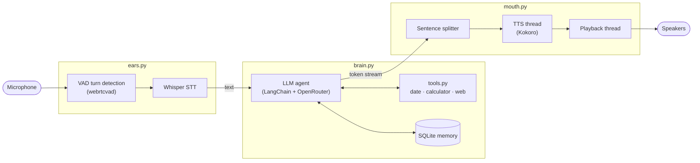

# Aeon — bilingual hands-free voice assistant

Talk to it in **Spanish or English**, no push-to-talk needed: Aeon notices when you start and stop speaking,
thinks with an LLM agent that can use tools and remembers past conversations, and answers out loud,
starting to speak while the rest of the reply is still being written.

Speech recognition (Whisper) and speech synthesis (Kokoro) run **locally on the GPU** through
[Voicebox](https://github.com/jamiepine/voicebox); the reasoning runs on any OpenRouter model (GPT-4o by default).

## Features

- **Hands-free turns** — voice activity detection decides when you start and finish talking.
- **Bilingual** — replies in the language you spoke, and each sentence is voiced by a Spanish or English voice.
- **Low latency** — the reply is cut into sentences as the LLM streams it; the first sentence plays while the next ones are generated.
- **Tools** — current date and time, a safe calculator and web search; says "Let me check…" instead of going silent while a tool runs.
- **Long-term memory** — conversations persist in SQLite and resume on the next run.
- **Barge-in** — interrupt it by speaking (with headphones).
- **Resilient** — a failed turn (network, API, speech server) is reported and the conversation keeps going.

## How it works



Whisper and Kokoro run inside a local Voicebox server; `voicebox.py` is the HTTP client for it. `main.py` runs the conversation loop.

### Engineering highlights

| Problem | Approach | Where |
|---------|----------|-------|
| Waiting for the full reply before speaking feels slow | Split the token stream into sentences; the first one is emitted early, later ones are grouped (~120 chars) so intonation flows | `mouth.py` `SentenceSplitter` |
| Synthesis and playback in series leave gaps | Two threads joined by queues: one synthesizes sentence *n+1* while the other plays sentence *n*; `Event.wait` pauses can be cut instantly | `mouth.py` `Speaker` |
| Knowing when the user has finished talking | State machine over 30 ms VAD frames: start after 150 ms of speech, keep 300 ms of pre-roll so the first syllable isn't lost, stop after 800 ms of silence | `ears.py` `Ears.record` |
| Whisper "hears" phrases in background noise | Filter its typical hallucinations ("Thank you.", "Gracias.") | `ears.py` |
| Memory that grows forever gets slow and costly | Persist with a LangGraph SQLite checkpointer and trim to the last ~40 messages before each model call, always cutting at a user message so tool calls stay paired with their results | `brain.py` |
| An LLM tool must never execute arbitrary code | The calculator parses the expression with `ast` and only evaluates numbers and arithmetic operators (no `eval`, no powers) | `tools.py` |
| Choosing the voice without another model | Score each sentence with Spanish/English stop words and accents; ties keep the previous language | `mouth.py` `detect_language` |
| Misconfiguration surfacing as obscure errors later | Typed, validated settings (`pydantic-settings`), the API key as `SecretStr`, and one HTTP entry point that maps network failures and `202 downloading` to clear errors | `config.py`, `voicebox.py` |

## Tech stack

Python 3.12 · LangChain 1.x / LangGraph (agent, tools, checkpointer) · OpenRouter · Voicebox (Whisper turbo, Kokoro) ·
webrtcvad · sounddevice / soundfile · httpx · pydantic-settings · uv · ruff

## Getting started

**Requirements:** [uv](https://docs.astral.sh/uv/), an [OpenRouter API key](https://openrouter.ai/keys),
a running [Voicebox](https://github.com/jamiepine/voicebox) server (tested with v0.5.0), a microphone and speakers.
An NVIDIA GPU is optional but makes Whisper much faster. Tested on Windows 11.

```powershell
git clone https://github.com/midasestanislao/aeon-voice-assistant.git
cd aeon-voice-assistant
uv sync                      # creates .venv with Python 3.12 and the dependencies
copy .env.example .env       # then set OPENROUTER_API_KEY
```

Start the Voicebox backend. It runs from its own checkout with its own environment (PyTorch + CUDA), so set
`VOICEBOX_DIR` in `.env` to that folder (default: `.\voicebox` inside this project). It listens on port 17493:

```powershell
.\scripts\start_voicebox.ps1     # does nothing if Voicebox is already running
```

On the first run Aeon downloads the Kokoro and Whisper models through Voicebox if they are missing.

## Usage

```powershell
uv run python main.py                 # hands-free conversation
uv run python main.py --texto         # type instead of speaking (no microphone needed)
uv run python main.py --interrumpir   # interrupt Aeon by speaking (use headphones)
uv run python main.py --olvidar       # start with an empty memory
```

Say or type **"adiós"** / **"goodbye"** to exit. Every module also runs on its own as a small demo:

| Command | Demo |
|---------|------|
| `uv run python config.py` | Prints the settings (API key hidden) |
| `uv run python voicebox.py` | Server health, model check, and a TTS → STT round trip |
| `uv run python mouth.py` | Splits a reply into sentences, detects their language and speaks them |
| `uv run python tools.py` | Runs the date, calculator and web search tools |
| `uv run python brain.py` | Text chat with memory (`olvidar` clears it) |
| `uv run python ears.py` | Hands-free dictation |

## Configuration

Every field in `config.py` can be overridden in `.env` (`FIELD_NAME=value`), for example:

| Variable | Default | |
|----------|---------|-|
| `LLM_MODEL` | `openai/gpt-4o` | Any OpenRouter model |
| `VOICE_ES` / `VOICE_EN` | `ef_dora` / `af_heart` | Kokoro voices |
| `WHISPER_MODEL` | `turbo` | `base`, `small`, `medium`, `large`, `turbo` |
| `VAD_SILENCE_MS` | `800` | Silence that ends your turn |
| `MEMORY_MAX_MESSAGES` | `40` | Messages the model sees from the history |

## Project structure

```
config.py     settings loaded from .env, typed and validated
voicebox.py   HTTP client for Voicebox (health, models, voice profiles, transcribe, synthesize)
ears.py       microphone + VAD turn recording + transcription; barge-in watcher
brain.py      LLM agent with tools, SQLite memory and history trimming; streams the reply
tools.py      date/time, safe AST calculator, web search
mouth.py      markdown cleanup, language detection, sentence splitter, two-thread speaker
main.py       conversation loop and command-line options
scripts/      start_voicebox.ps1: starts the Voicebox server from VOICEBOX_DIR
```

Code comments are in Spanish: this project grew out of a step-by-step learning path.

## Known limitations

- Barge-in needs headphones: without echo cancellation the microphone hears Aeon's own voice.
- Kokoro is fast but less expressive than larger TTS models; a Spanish voice clone would need another Voicebox engine.
- Developed and tested on Windows; audio device handling on other systems has not been tested.
